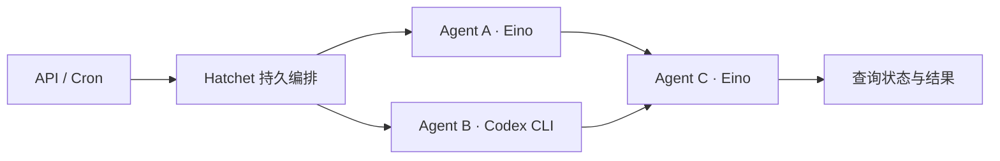

# Pangu

基于 **Hatchet + Eino + 原生 Codex** 的 Go Agent 工厂。使用 API 和 JSON 无环编排，支持自定义 Agent、节点级调度/重试/恢复、Cron 和结果查询。



每个 Agent 是独立的 Hatchet 子任务。持久编排派生子任务并等待结果；节点通过 `executor` 选择 Eino 或原生 Codex CLI。同层 Eino 节点并行；Codex 节点在同一命名空间内串行，下一层等待上一层完成。

## 版本与许可

| 组件 | 版本 |
| --- | --- |
| Go | 最低 1.26.7，本机验证 1.26.10 |
| Hatchet SDK / embedded | v0.110.5 |
| Eino | v0.9.22 |
| Eino OpenAI 组件 | v0.1.13 |
| Codex CLI | 本机验证 0.163.0 |

Hatchet 使用 [MIT 许可](https://github.com/hatchet-dev/hatchet/blob/v0.110.5/LICENSE)，可完整本地自托管，无需 Hatchet Cloud 账号。Eino 使用 Apache-2.0；Pangu 保持仓库原有 [AGPL-3.0 许可](LICENSE)。

## Windows 本地启动

在仓库根目录运行。需要 Go；如果使用本次初始化下载的工具链，先设置当前终端 PATH：

```powershell
$env:PATH = "$PWD/.tools/go/bin;" + $env:PATH
powershell.exe -NoProfile -ExecutionPolicy Bypass -File ./scripts/hatchet.ps1 -Background
```

首次运行会编译官方 sidecar、下载 PostgreSQL 并迁移数据库。等待 `.tools/hatchet-connection.json` 生成，再加载连接信息和模型凭据：

```powershell
. ./scripts/hatchet-env.ps1
$env:OPENAI_API_KEY = '你的模型服务密钥'
$env:OPENAI_BASE_URL = '兼容 OpenAI Chat Completions 的 API 地址'
go run ./cmd/pangu
```

`OPENAI_BASE_URL` 留空时使用组件默认 OpenAI 地址。模型名在编排 JSON 中指定。程序不自动加载 `.env`，配置项见 [.env.example](.env.example)。真实密钥不得提交。

| 服务 | 地址 |
| --- | --- |
| Pangu API | `http://127.0.0.1:8080` |
| Hatchet REST | `http://localhost:28243` |
| Hatchet gRPC | `127.0.0.1:17070` |

默认同时启动 API 和 Worker。可分别运行 `go run ./cmd/pangu -mode api` 与 `go run ./cmd/pangu -mode worker`。修改进程外的环境变量后，需要重启对应进程。

若 8080 被占用，使用 `go run ./cmd/pangu -port 8081`，仍仅监听 `127.0.0.1`；下方 API 示例地址也需改成所选端口。本次部署所在机器的 8080 已被 VS Code 占用。

本地数据位于 `.tools/hatchet-postgres/`，连接令牌在 `.tools/hatchet-connection.json`，随机管理员密码在 `.tools/hatchet-admin-password`，日志在 `.artifacts/hatchet.stderr.log`。管理员账号是 `admin@example.com`。上述本地文件全部被 Git 忽略；本次没有启动 Hatchet Dashboard。

停止后台引擎：

```powershell
powershell.exe -NoProfile -ExecutionPolicy Bypass -File ./scripts/hatchet-stop.ps1
```

等待端口释放再启动。数据库会保留，但重启产生新令牌，应重新加载 `hatchet-env.ps1` 并重启 Pangu。

**网络边界：** Pangu 仅监听回环地址，供本机受信用户使用，没有独立认证。官方 embedded REST 监听所有网卡的 28243 端口；其令牌和管理员密码已随机生成，仍应通过 Windows 防火墙阻止远程访问。本机账号无管理员权限检查或调整具体防火墙规则，未验证远程可达性。开发端口不应开放到公网。

## 原生 Codex Agent

先安装 Codex CLI 并执行 `codex login`。Pangu 通过官方 [`codex exec`](https://learn.chatgpt.com/docs/non-interactive-mode) 启动原生 Agent，支持读取项目、运行工具和修改文件。它使用 Worker 账号的 Codex 登录和配置；纯 Codex 编排不需要 Eino 的 `OPENAI_API_KEY`。

在启动 API/Worker 的同一终端设置：

```powershell
. ./scripts/hatchet-env.ps1
$env:HATCHET_CLIENT_NAMESPACE = 'pangu'
$env:PANGU_CODEX_WORKSPACE = 'C:\你的项目绝对路径'
# npm 安装的 Windows x64 Codex 原生程序位置：
$env:PANGU_CODEX_BINARY = "$env:APPDATA/npm/node_modules/@openai/codex/node_modules/@openai/codex-win32-x64/vendor/x86_64-pc-windows-msvc/bin/codex.exe"
& ./.tools/go/bin/go.exe run ./cmd/pangu -port 8081
```

其他安装方式需填写实际原生可执行文件的绝对路径；Linux 可通过 `command -v codex` 定位。不要传入 Windows 的 `.cmd` 或 `.ps1` 启动脚本。工作目录必须是现有 Git 项目；API 和 Worker 的命名空间必须相同，每个命名空间只对应一个项目。

另开终端提交 [Codex 示例](examples/codex.json)：

```powershell
curl.exe -X POST http://127.0.0.1:8081/runs -H 'Content-Type: application/json' --data-binary '@examples/codex.json'
```

Codex 节点可省略 `model`，采用 CLI 自身配置；填写时通过 `--model` 传入。它与 `executor: "eino"` 的节点使用相同依赖、输入和输出结构，可以混合编排。每次执行重新读取 Worker 配置，JSON 不能指定可执行文件、工作目录或任意 CLI 参数。

Codex 固定使用 `workspace-write` 沙箱和 `never` 审批策略，不能交互批准越界操作，也不使用沙箱绕过参数。保留 CLI 的规则、技能及其他本机配置；配置与工具应由 Worker 管理者信任。进程环境不传递 Hatchet 令牌、Pangu 内部配置及 Eino 的 `OPENAI_API_KEY`/`OPENAI_BASE_URL`，避免混用模型连接。需要 API Key 认证时，按 Codex CLI 的方式配置自己的登录或 `CODEX_API_KEY`。

文件修改直接落在指定项目中；重试不会回滚已写入的文件，也不会恢复 CLI 内部会话。请用幂等任务指令，并通过 Git 检查修改。Codex 沙箱允许读取项目以外的部分文件；本功能不提供多用户文件隔离。

## API

先将 [examples/workflow.json](examples/workflow.json) 的模型名称替换为你的模型服务支持的名称：

```powershell
curl.exe -X POST http://127.0.0.1:8080/runs -H 'Content-Type: application/json' --data-binary '@examples/workflow.json'
# 返回 202：{"run_id":"UUID"}
curl.exe http://127.0.0.1:8080/runs/返回的UUID
```

查询返回 `run` 和 `nodes`。`run` 保留 Hatchet 运行详情，`run.run.status` 是整体状态；`nodes` 包含直接子任务的输入、输出、错误和重试信息。节点的 `additionalMetadata.pangu_node_id` 对应 JSON 节点 ID。刚提交的运行可能暂未同步到查询视图，短暂返回 404 时可等待后重试。

创建每天 UTC 02:00（新加坡/北京时间 10:00）的 Cron：

```powershell
$definition = Get-Content -Raw -Encoding UTF8 ./examples/workflow.json | ConvertFrom-Json
$cron = @{ name = 'daily'; expression = '0 2 * * *'; workflow = $definition }
$body = $cron | ConvertTo-Json -Depth 20
Invoke-RestMethod -Method Post -Uri http://127.0.0.1:8080/crons -ContentType 'application/json; charset=utf-8' -Body $body
curl.exe 'http://127.0.0.1:8080/crons?offset=0'
curl.exe -X DELETE http://127.0.0.1:8080/crons/返回的metadata.id
```

| 接口 | 成功状态 | 作用 |
| --- | --- | --- |
| `GET /healthz` | 200 | 进程存活，不代表依赖就绪 |
| `POST /runs` | 202 | 校验并提交完整编排 |
| `GET /runs/{id}` | 200 | 查询运行和直接子任务 |
| `POST /crons` | 201 | 创建 UTC 五字段定时触发 |
| `GET /crons?offset=0` | 200 | 每页最多 100 条 |
| `DELETE /crons/{id}` | 204 | 删除定时触发 |

参数错误返回 400，过大请求返回 413，非 JSON 类型返回 415；Hatchet 请求失败返回 502；运行不存在或尚未同步返回 404。首次注册尚未完成时返回 503，应先启动 Worker。提交前直接查询 Hatchet 工作流注册状态，不缓存配置。API 使用配置的 Hatchet 租户权限，没有额外的用户或租户隔离。

连接其他 Hatchet 实例时，显式设置 `.env.example` 中全部五个连接变量，包括 `HATCHET_CLIENT_TENANT_ID` 和 `HATCHET_CLIENT_SERVER_URL`。SDK 的 Cron 删除封装只接受 200，本项目使用其官方生成的 REST 客户端按接口定义处理 204。

## 执行边界

- 自定义节点包括必填执行器 `executor`、模型名、指令、描述及依赖 ID。Eino 接收原始指令及包含 `input`/`parents` 的 JSON 用户消息；Codex 从标准输入接收完整节点任务及直接上游输出。
- 不缓存编排配置：运行使用提交的完整不可变定义；模型配置在节点执行时读取环境变量。Cron 保存提交时的定义，修改需删除并重新创建。
- 最多 32 个节点、256 KiB 请求体；拒绝未知字段、错误依赖、重复节点和循环。指令最多 16 KiB、模型名最多 128 字节、描述最多 1 KiB、节点输出最多 16 KiB。
- 加入上游输出后，单节点 JSON 序列化输入最多 1 MiB；超限时该层不会派生任务。
- 节点失败最多重试两次；Eino 节点执行超时 3 分钟、模型超时 2 分钟，Codex 节点执行超时 30 分钟、CLI 超时 25 分钟、排队超时 6 小时。整条编排超时 6 小时。失败耗尽时停止下游，同层已派生的节点可能继续完成。
- 恢复依赖 Hatchet 数据库及匹配的 Worker。完成节点沿用持久结果；节点内部中断的模型调用可能重复计费，不保证外部副作用恰好一次。
- 当前工作流名为 `pangu-orchestrate-v2`；`executor` 是必填字段，没有旧格式回退。已有 JSON 和 Cron 必须补齐执行器并重新提交；不要将新 Worker 用于恢复旧版未完成运行。
- Codex 取消时清理进程树；Windows 使用 Job Object，在 Worker 被终止时一并清理。Linux 取消会清理进程组，但强制杀死 Worker 时仍可能留下 CLI 的外孙进程。
- Cron 使用 UTC，停机期间漏跑不自动补跑。删除 Cron 不取消已触发的运行；入队后也可能因资源不足等待。
- 本地 embedded 是开发环境，密钥和运行数据在同一台机器，不作为生产加密隔离或高可用方案。

Eino 节点是可配置的 ChatModelAgent，每节点一次模型生成；Codex 节点是具备工具调用能力的完整原生 Agent。暂不包含管理后台、可视化编辑、条件分支、循环、工具插件管理和多用户权限系统。

## 验证与开发

```powershell
go test ./...
go vet ./...
go build ./cmd/pangu

# 真实 Hatchet 集成测试，模型使用本地 HTTP 测试服务。
. ./scripts/hatchet-env.ps1
go build -o .tools/pangu.exe ./cmd/pangu
$env:PANGU_INTEGRATION = '1'
$env:PANGU_TEST_BINARY = "$PWD/.tools/pangu.exe"
go test ./internal/scheduler -v -count=1 -timeout=5m
```

集成测试使用隔离命名空间，覆盖节点重试、强制终止 Worker 后恢复、Cron 触发及删除、200 KiB 输入的 32 节点编排。测试 Cron 会删除，运行记录保留。未设置 `PANGU_INTEGRATION` 时显式跳过外部服务测试。CI 配置了测试、竞态检测、静态检查和构建。

Codex 单元测试使用受控子进程，覆盖配置、参数、输出限制和子进程清理；Hatchet 测试覆盖 Codex 串行、重试和混合编排。真实 Codex 测试会调用登录账号并消耗额度，需额外设置 `PANGU_CODEX_REAL=1` 及 `PANGU_CODEX_BINARY` 后运行；测试只在临时 Git 项目写入文件。范围见 [Codex 执行器](specs/Codex执行器.md)。

`cmd/pangu` 是入口；`internal/workflow` 定义和校验编排；`internal/scheduler` 接入 Hatchet；`internal/agent` 执行 Eino；`internal/api` 提供 HTTP 接口。详见 [需求与验收](specs/最小链路.md)、[验证记录](docs/验证记录.md)。

全部文件仅使用 Git，豁免 P4。采用 TDD，函数不超过 70 行；代码按用户最终选择使用 Codex 原生 Agent 审查。
