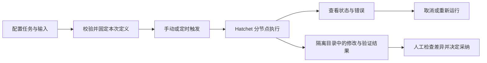

# Pangu 产品需求

> 2026-10-28 归属模型更新：角色、工作流和模型连接在工作空间共享，运行时选择项目；模型连接无需项目授权登记。本文旧的模板绑定/项目连接设计仅保留为历史背景，当前以 [共享角色与工作流](../specs/共享角色与工作流.md) 为准。

规划日期：2026-10-23，原始基线：`2121bd3`。本文保留产品目标与验收标准；实施已推进至业务功能、控制台与本地恢复，当前状态以 [实施进度](实施进度.md) 和 [README](../README.md) 为准，真实验收未完成的里程碑不提前关闭。

## 1. 产品定位

Pangu 是面向个人开发者和研发小团队的 Agent 工厂，让用户把重复的研发工作配置成可复用、可定时运行、可检查结果的 Agent 工作流。

用户已确认先以“日常可用”为目标：一个真实流程可以重复运行，失败可以定位和恢复，代码修改可以审查。技术沿用 Go、Hatchet、Eino 和原生 Codex；先完善 API 与 JSON 配置，后增加界面。

最新确认：Agent 模板跨项目共享，绑定后的项目 Agent 不可迁移；首个 Eino 专业角色为产品经理，具备调研、竞品分析、产品规划、方案设计；团队使用飞书登录。其余决策与数值见 [需求确认记录](需求确认记录.md)，具体接入资源未提供的部分仍待补充。

## 2. 背景与问题

当前已打通 JSON 提交、节点独立调度与重试、Worker 重启恢复、Eino/Codex 混合执行、Cron 和按 ID 查询结果，具备执行内核。

原始基线的缺口包括配置复用/版本管理、运行操作、隔离工作区与变更交付、安装与恢复。这些已进入本轮实现；尚未开展真人试点，具体任务频率、节省时间和采纳率不能当作已验证事实。

## 3. 目标与成功标准

以下数字已作为发布验收门槛采纳，不是现有性能或用户数据；实际执行尚待验证。

| 目标 | 对应阶段 | 验收与测量方式 |
| --- | --- | --- |
| 一个真实研发流程可反复使用 | M1 | 选定一个真实 Git 项目和一条流程，连续执行 10 次；每次均能定位状态、节点和结果，至少 8 次产物通过预先约定的人工验收；服务故障和模型质量分别统计，不把进程退出成功当成任务完成 |
| 失败可控，修改可检查 | M1 | 节点失败、超时、用户取消、Worker 重启四类场景全部通过；自动恢复不重跑已完成节点；失败尝试不污染后续文件输入；源工作区不被后台任务改写；每次写入运行有差异与验证证据 |
| 用户通过配置复用工作流 | M2 | 产品经理、小范围修改与验证、只读项目巡检三类模板无需修改 Go 代码即可使用；同一 Agent 模板可跨项目绑定，绑定后不可迁移；手动与定时触发均可用，历史运行和计划保留原版本 |

同时记录首次成功耗时、人工求助次数、失败原因、排队/执行时长和产物采纳情况。模型用量只记录供应商实际返回的数据；无法获取时显示“未知”，不伪造精确费用。

## 4. 目标用户

| 用户 | 要完成的工作 | 产品边界 |
| --- | --- | --- |
| 个人开发者，首批核心用户 | 把需求分析、代码修改、验证、总结串成可重复流程；让周期性巡检自动执行 | 可使用 API/JSON，拥有本机和项目权限，愿意人工检查代码结果 |
| 研发小团队中的流程维护者，后续试点用户 | 共享 Agent 和流程版本，查看同事发起的任务，定位失败与变更来源 | 先服务相互信任、共享项目权限的小团队；远程多人使用前必须补齐认证、授权与审计 |

非技术业务人员、互不信任的外部租户和商业化平台不属于近期目标。

## 5. 用户价值

首批用户的价值主张如下，涉及现有工作方式的描述仍需在试用时核实。

- **谁**：需要反复处理同类研发任务的个人开发者。
- **为什么**：希望把已经有效的 Agent 操作固化，减少每次手工组织指令、检查状态和整理结果的工作。
- **使用前**：可能依赖手动调用 Codex、复制提示词或自写脚本；目前缺少对此习惯的访谈证据。
- **如何解决**：通过有版本的 Agent 与流程配置，交给 Hatchet 调度，由 Eino 和 Codex 执行，并保留运行记录及文件差异。
- **使用后**：同一流程可以再次运行或定时执行，用户知道失败在哪里，也能在采纳结果前检查修改。
- **替代方式**：继续手动使用 Codex 或维护脚本。Pangu 的价值应由重复执行、故障处理和结果审查的实际便利性证明。

对团队维护者：将个人验证有效的流程发布给可信同事，替代各自维护的脚本与指令副本；通过版本引用、权限和审计，使共享流程可追溯。此价值在 M3 试点验证。

## 6. 核心使用流程

首个代码交付验收使用 Pangu 独立副本的小范围修改：需求分析（Eino）→ 修改并执行项目验证（Codex）→ 结果总结（Eino）→ 人工检查文件差异；具体任务/基准/验证命令在 R01 固定。模型自述不能代替文件和测试证据。

M2 首个 Eino 专业角色为产品经理：调研 → 竞品分析 → 产品规划 → 方案设计，各能力也可单独调用。交付有来源和时间信息的调研报告、竞品矩阵、PRD/路线图、方案及任务卡；事实、推断与未知分开。底层提供受控搜索、资料读取与产物工具，不把只有角色提示词视为功能完成；不自动发布文档、发送消息或执行生成任务。

M1 使用完整 JSON；M2 增加模板、版本和参数；M3 提供同一套能力的界面。

## 7. 功能范围与原则

| 功能域 | 当前已有 | 近期需要补齐 | 阶段 |
| --- | --- | --- | --- |
| 自定义 Agent | 指令、执行器、模型、依赖；Eino 单次模型调用与原生 Codex | 跨项目模板、不可迁移的项目绑定、版本、试运行、产品经理角色四类能力及受控工具 | M2 |
| 自定义编排 | 最多 32 节点的 DAG，按层执行 | 单独校验、输入参数、版本绑定、结构化结果与字段映射 | M1–M2 |
| 运行管理 | 提交与按 ID 查询，节点自动重试/恢复 | 列表筛选、统一状态、事件、取消、人工重新运行 | M1 |
| Codex 代码交付 | 在 Worker 指定项目直接读写 | 独立工作区、失败尝试处理、差异与验证证据、人工导出采纳 | M1 |
| 定时任务 | UTC 创建、列表、删除，定义快照 | 重叠控制、启停、编辑、版本绑定和下一次触发预览 | M1–M2 |
| 管理界面 | 基础状态页 | 运行控制台、共享模板/项目 Agent、JSON 编辑、只读流程图、差异、项目成员和模型连接引用管理 | M3 |
| 本地与团队运行 | 本地部署脚本、回环 API | 就绪诊断、数据恢复、凭据脱敏；飞书登录、Pangu 项目授权和审计 | M1–M3 |

原则：Hatchet 负责调度和执行状态，Eino/Codex 负责节点执行；Pangu 补产品配置、运行操作和交付能力，不另造调度引擎。配置每次读取原始来源，索引随重载重建；运行的不可变定义是执行证据，不是可变配置缓存。凭据不写入流程、运行快照和输出。

Codex 原生登录和配置继续由 Worker 管理，用户输入不能指定任意路径、程序或 CLI 参数。工作区隔离用于保护代码变更，不能替代操作系统级权限隔离；外部工具的副作用仍不保证恰好一次。

### 待验证与设计边界

- 先沿用 Windows 本地运行环境；其他操作系统只有通过进程清理与恢复测试后才声明支持。
- M1 暂保留一命名空间一项目、Codex 串行、UTC、漏跑不补跑和分层 DAG，控制首版范围。
- 首个场景使用 Pangu 独立副本；具体验收任务在 M1-01 固定。独立产品库、独立 clone 和绑定不可迁移等产品边界已确认；Hatchet 取消/防重、工作区恢复、飞书登录接入仍须技术实证，不把产品确认当成实现通过。
- 不承诺模型结果每次相同、外部副作用自动撤销或零成本重试。运行结束不等于代码可合并。

## 8. 发布范围

按 **M1 可控执行 → M2 可复用工厂 → M3 小团队控制台** 推进。每阶段通过验收后再进入下一阶段，具体任务、依赖和完成定义见 [路线图与任务清单](Outcome-Roadmap-2026.md)。

近期不实现拖拽画布、无限循环、通用插件市场、知识库平台、跨租户 SaaS、计费系统、自动合并代码或大规模高可用。先通过真实使用验证这些需求，再决定是否立项。

尚无团队投入信息，不承诺日历日期。每个阶段开始前按任务规模估算，关键技术验证完成后再排期。
