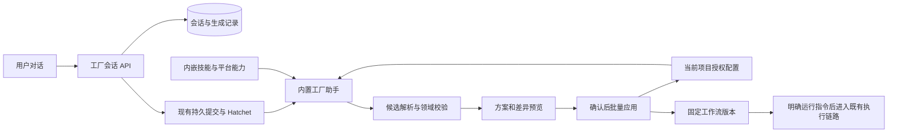

# 对话式 Agent 工厂设计与实施拆分

日期：2026-10-27。状态：用户已确认，CF01—CF09 已实现并部署本机；采用“预览后确认一次，系统批量创建并发布；明确运行才执行”。本轮完成本地与模拟验收，未消耗真实模型额度，详见[使用与验收](对话式Agent工厂使用与验收.md)。

## 1. 产品目标

用户通过与内置“工厂助手”对话，创建和调整 Agent 及 workflow。常规使用不要求先准备助手、填写配置文件、逐个发布 Agent 或手动连线。

例如用户说：“为 Pangu 建一个竞品调研与产品规划流程，先分析竞品，再输出下一阶段计划。”工厂助手结合项目已有能力，澄清必要范围，生成需要的助手、交接契约与流程，展示可理解的方案。用户继续说“增加一次只读审查”，系统修改候选并展示差异。

成功标准是生成可持久保存、通过服务端校验且可被现有 Worker 执行的真实资源。聊天回复“已创建”或输出 JSON 不算完成。

## 2. 参考与选择

参考官方说明：

- [n8n AI Workflow Builder](https://docs.n8n.io/advanced-ai/ai-workflow-builder/)：自然语言生成、调整和调试流程，自动选择与配置节点，生成后审阅。
- [Langflow Assistant](https://docs.langflow.org/langflow-assistant)：内置助手理解当前图结构，通过自然语言创建流程和组件；生成助手与被生成的业务流程分离。
- 用户提供的 [build-optimize-workflow](../skills/build-optimize-workflow/SKILL.md)：优先最小有效流程，清晰交接与权限预算，以独立评估决定是否采用优化。

上述资料作为交互与职责划分参考，不引入第二套调度框架，也不宣称其能力已经存在于 Pangu。

| 方案 | 结果与代价 |
| --- | --- |
| 对话生成配置文本，由人导入 | 改动小，但用户仍承担配置、发布与连线，不能满足目标 |
| 内置工厂助手生成候选，程序校验并创建真实资源（推荐） | 复用现有版本与执行链路；对话完成设计，程序保证落库、权限及引用有效 |
| 模型直接修改数据库、代码和运行配置 | 难以控制部分成功、权限与历史污染，不采用 |

## 3. 建议的创建和执行规则

1. 对话及生成候选自动保存，不要求逐项确认字段。
2. 工厂助手自动生成完整的五项交接契约、职责、执行方式、已授权模型连接、限制、输出结构和节点依赖。
3. 生成完成后展示“将创建/复用/修改什么”、流程预览、资料与权限范围、未解决事项及预算。人只需对整体方案确认一次，系统批量创建并发布，所有动作返回真实资源链接。
4. 仅创建不运行。用户随后明确发出“运行”或选择“创建并运行”时，系统在展示具体输入与授权范围后走现有任务提交入口；不因一般聊天、生成或优化而执行项目写入任务。
5. 修改既有对象必须明确目标。默认复用满足条件的固定版本；需要修改时展示差异并创建新版本，不影响已有工作流、Cron 或在途运行。
6. “优化这个流程”生成候选版本与验证建议，不自动扩大权限、预算、评分规则或部署范围。缺少真实证据时只能说明预期效果，不能声称已经提升质量。

本节规则已由用户确认。生成候选不能代替创建确认；创建确认不能代替正式任务的运行指令。

## 4. 首页和工作台

主入口改为“与工厂助手对话”。先选择项目，再描述目标，无需先选择一个已经发布的助手。提供“创建助手”“创建流程”“调整现有流程”“诊断与优化”等开场示例。

桌面采用对话与方案预览两栏：对话记录显示当前阶段和实际操作结果；预览区显示 Agent 卡片、交接契约、节点顺序、依赖与配置差异。画布继续使用 React Flow 自动布局，作为解释生成结果与高级编辑的入口。

已有助手工作台、工作流画布、版本、任务记录、自动化、账号与权限仍可查看使用；手动创建入口从主流程移到高级设置，不删除历史资源。模型连接和项目授权仍由有权限的管理者配置，工厂助手不能创建凭据或扩大项目权限。

刷新可恢复会话、生成进度、候选和创建回执。发送中、已生成、校验未通过、等待确认、正在创建、已创建和失败均使用真实服务端状态，不伪造逐字生成。

## 5. 工厂助手与业务 Agent 的分工

工厂助手内置在应用中，不依赖用户事先手动创建一个 Agent，避免首次使用无入口。它读取工作空间共享的模型连接、Agent/工作流版本和内置能力说明；有唯一可用连接时自动选取，多个连接时展示可读选项，不能猜测凭据。

生成侧沿用 Eino 与 Worker 的 Codex 模型桥接；原生 Codex 仍作为被生成流程中的业务执行器。对话生成只负责结构化候选，不直接运行 shell、修改项目文件或调用任意平台 API。明确要求诊断时，只读取用户所选且有权访问的运行证据。

生成轮次使用现有持久提交、Hatchet、取消与用量记录机制；API 不在 HTTP 请求中启动无人管理的模型进程。每轮固定会话修订、输入与所用版本；同轮重试复用回执。模型调用失败或结果未知时展示状态，不偷偷重复收费调用。

普通问答、澄清和生成都属于模型调用，界面需明确会使用已配置账号额度。生成预算与业务流程运行预算分开显示；生成器不能通过多轮修正绕过总上限。具体上限沿用平台已授权限制，不采用技能文档中的示例预算。

## 6. 内置技能接入

本机已安装到 `C:\Users\pengtaotao\.codex\skills\build-optimize-workflow`；项目内原文位于 `skills/build-optimize-workflow`。

平台集成时通过 Go 内嵌资源随发布包交付，不依赖用户个人技能目录。每次生成读取内置原文并记录技能内容摘要，开发环境和部署包使用同一份资源；不创建可变业务配置缓存。

按任务加载材料：

| 场景 | 使用内容 |
| --- | --- |
| 新建或调整 Agent/流程 | 技能主体、交接契约、Pangu 当前能力与输出约束 |
| Eino/Codex 职责划分 | 追加 `references/eino-codex.md` |
| 诊断、评估与优化 | 追加 `references/evaluation.md` 以及获准的运行证据 |

`workflow-spec.yaml` 只用于指导方案组织，用户不需要填写 YAML，也不能直接导入为执行配置。生成结果必须转换为 Pangu 的 Node、Flow、Binding 等当前领域类型。

技能不能替代硬校验；其中关于缓存的通用建议不适用于可变配置。项目规则、用户授权及程序强制权限优先。工厂助手不能修改自己的技能、评分器或权限以获得通过。

## 7. 服务端模块与数据流

沿用 Go 模块化单体、PostgreSQL、Hatchet、Eino/Codex 和 React。新增功能集中在 `factory`，资源批量应用仍归 `catalog`，避免再造一套 Agent/Workflow 存储。

新增持久数据包括会话、消息/生成轮次、候选修订与应用回执。保存来源用户、项目、模型连接版本、技能摘要、当前状态、候选内容和关联提交 ID。原始凭据及模型隐式思维链不进入会话或日志。

会话固定项目；发起人和项目管理者可继续操作，查看权限按现有身份模型验证。改项目须新建会话，不能搬移已有 Agent。每轮重新从数据库读取授权配置，历史对话只保存执行所需快照及证据，不作为最新配置来源。

初版接口集中在 `/factory/sessions`、会话消息/轮次查询、候选检查和应用，不新增通用工具执行 HTTP 入口。OpenAPI 先定义产品 DTO，再生成 TypeScript 类型。

## 8. 生成、校验和批量落库

模型只返回“澄清问题”或“候选变更”，不能返回任意 SQL、文件路径或可执行脚本。新助手用候选内临时标识关联，真实 UUID 和版本由服务器生成；既有资源必须引用授权范围内的真实 ID。

服务端校验职责、五项交接契约、模型连接、执行方式、工具与文件权限、预算、节点上限、DAG、条件、审批及输入输出映射。使用当前已支持的结构，不假定拥有循环、任意 MCP、自定义插件等尚未实现的能力。

一个 Agent 能完成的请求只创建一个 Agent，不为了“多 Agent”强行增加节点。资料不足时提具体问题；不能用示例占位内容填满契约后宣称完成。

批量应用在同一产品数据库事务内创建/更新 Agent、发布 Agent 版本、解析真实引用并创建/发布工作流。复用 `catalog` 现有校验，提取必要的事务内函数，不复制业务规则。全部成功才提交；失败不留下半套助手或错误发布版本。

会话修订、既有对象修订和候选摘要共同防止并发覆盖。重复确认返回同一应用结果；候选变化或对象被他人修改时返回冲突并展示差异。权限在最终应用前重新验证，模型没有独立身份或更高权限。

模型生成与数据库提交不组成跨服务原子事务。先持久化轮次与回执，再生成和校验；应用事务独立执行。执行任务则复用既有提交对账机制，不能把“创建成功”误报为“执行成功”。

## 9. 边界与保留

- 本轮覆盖对话创建、澄清、修改候选、复用已有助手、交接契约生成、批量发布及显式运行，包含根据所选运行证据提出优化候选。
- 既有定时任务继续使用固定版本；本轮不增加自主创建 Cron、自动定期优化、自动改代码框架或无限多 Agent 循环。
- 不接入第二套可视化平台，不让模型绕过 catalog 直接写数据库。
- 已发布版本、旧任务与在途运行不被改写。旧配置缺少契约时，可在对话中生成补齐候选，再按确认规则发布。
- 会话正文和候选采用现有临时正文 30 天、回执元信息 90 天、审计 180 天原则；活动生成与引用受保护。正文到期后保留状态和已生成资源链接，不再继续使用已过期上下文。
- 未接入长期记忆、向量库或跨项目私有资料检索。

## 10. 可独立执行的任务

| 编号 | 内容 | 依赖 | 可验收结果 |
| --- | --- | --- | --- |
| CF01 | 安装并纳入技能资源 | 无 | 本机安装与项目副本 7 文件摘要一致；已完成 |
| CF02 | 内嵌技能、内容摘要与生成协议 | CF01、规则确认 | 部署不依赖个人技能目录；明确的澄清/候选类型及大小边界；错误输出被拒 |
| CF03 | 会话、轮次和候选持久化及 API | CF02 | 刷新恢复、项目隔离、修订冲突、同键回执、保留清理通过数据库与接口测试 |
| CF04 | 工厂助手生成接入 | CF02、CF03 | 使用现有账号生成候选；能澄清缺项；固定上下文来源与版本；可取消且预算不被重置 |
| CF05 | 候选校验与事务批量应用 | CF02、CF03 | 真实 Agent/版本/Flow 一次创建；失败回滚、重复确认不重复创建、越权与失效引用拒绝 |
| CF06 | 对话首页、阶段状态与方案预览 | CF03、CF04、CF05 | 无须手动创建助手或连线即可完成流程创建；现有画布用于查看；窄屏、错误恢复和历史入口可用 |
| CF07 | 既有配置调整与证据驱动的优化候选 | CF04、CF05、CF06 | 对话修改明确目标，展示差异；保留旧版本；缺证据不宣称优化有效；不改权限和验收门槛 |
| CF08 | 对话到正式执行衔接 | CF05、CF06 | 具体输入与授权可见，明确运行指令后复用现有提交与回执；只创建不触发业务模型任务 |
| CF09 | 验收、原生审查与部署 | CF02—CF08 | 模拟/数据库/Hatchet/浏览器测试通过，真实模型结果单独记录，更新运行说明与回退步骤 |

沿用已确认的 Git、TDD 与 Codex 原生 Agent 审查，不重新询问这些工程约定。实现按依赖推进，每项先失败测试再实现；保持函数规模限制，只改本功能触及的边界。

## 11. 验收案例

1. 项目没有手工创建的 Agent 时，通过对话创建一个只读助手，交接契约完整，返回真实对象与版本链接。
2. 对话创建“竞品分析 → 产品规划”流程，正确固定 Agent 版本、依赖和资料输入；用户不填写 JSON 或手动连线。
3. 接着说“加入只读审查”，仅修改候选；应用后形成新版本，旧引用和旧任务保持原样。
4. 请求不存在的工具、跨项目资源、循环依赖或缺关键资料时，指出具体限制或提问，不生成假能力。
5. 校验、发布中途失败、重复发送、重复确认、撤权、并发修改、服务重启都不产生重复或半套配置。
6. 刷新浏览器后能找到当前候选与真实回执；取消生成后不继续落库。
7. “仅创建”不启动业务任务；“运行”按已确认输入和权限执行，失败保留可查询回执。
8. 优化请求缺少运行证据时标明假设；有证据时生成可比较候选，不能改评分器或伪造验证结果。

真实模型验收沿用既有单独预算授权约定。未授权前可以完成代码、模拟、数据库和本地 Hatchet 验证，不消耗账号进行真实生成测试。
