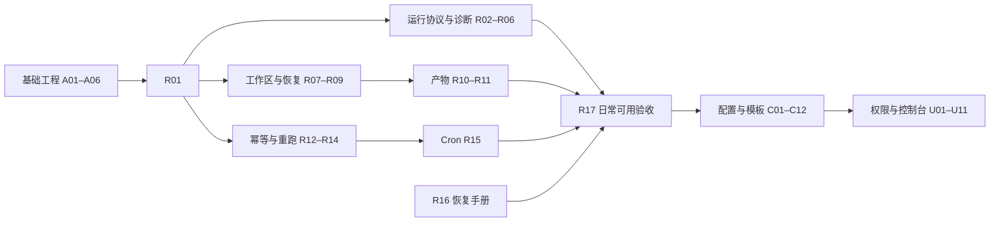

# Pangu 可独立领取的工程任务

本清单把 [产品路线图](Outcome-Roadmap-2026.md) 转成工程交付单元，架构约束见 [架构设计](架构设计.md)。基础工程 6 项；后续共 **46 项任务：R01–R17、C01–C16、U01–U13**。卡片保留原始交付范围，当前完成情况和未通过的外部验收统一见[实施进度](实施进度.md)，不要把本清单整体视为未实施。

用户已确认 Q17 跨项目模板绑定不可迁移、Q21 产品经理角色、Q23 飞书登录，其余采纳推荐。执行时读取 [需求确认记录](需求确认记录.md) 中对应规则和数值；[原始盘点](待确认事项盘点.md)保留技术待验证项。确认不代表功能已实现。

“可独立执行”指前置任务完成后，执行者可以根据本卡实现、测试和提交一个完整结果，不是所有任务都没有依赖。用户已授权持续完成全部任务，当前进度见[实施进度](实施进度.md)。每项默认一个独立 PR；复杂故障实验可以先交付测试证据，再实施对应行为。

## 基础工程的初始交付记录

以下记录基础阶段的验证边界；其中尚未实施的业务表、运行 DTO 与管理页面已在后续任务实现，当前状态以实施进度为准。

| ID | 交付物 | 验证边界 |
| --- | --- | --- |
| A01 | 模块边界、数据归属、执行与部署架构 | 架构文档和 Go 静态边界检查已落地；业务模型尚未建表 |
| A02 | 独立产品/测试数据库及账号，建库和迁移工具 | 本机真实 PG 迁移通过；未提供生产密钥托管或高可用 |
| A03 | OpenAPI 当前契约、前端类型生成和漂移检查 | 当前原始 Hatchet 响应已标明；稳定运行 DTO 待 R01/R02 |
| A04 | HTTP 请求追踪、纯校验接口、基础依赖检查 | 不等于节点事件、在线 Worker 或模型可用性检查 |
| A05 | React/TypeScript/Vite 工程与状态页 | 加载、断连、依赖异常、刷新测试及实际浏览器联调通过；无业务管理页面 |
| A06 | 锁文件、行尾约束、统一检查入口及 CI 配置 | 本地检查与原生 Codex 审查；远端 CI 需提交后运行 |

## 领取方式和通用完成标准

执行者领取一项时，读取其卡片、前置任务交付物和对应产品验收项；不要为完成一张卡实现后续卡的全部功能。新增目录只在有真实代码时创建。

- 后端验证入口：`go test ./相关模块/...`，然后 `go test ./...`、`go vet ./...`、`go build ./cmd/...`。本机可使用 `.tools/go/bin/go.exe`。
- 数据库任务：使用 `PANGU_TEST_DATABASE_URL` 指向独立 `pangu_test`；不得用产品库或 Hatchet 库跑破坏性测试。新增迁移必须验证重复执行、失败回滚和已有数据升级。
- 前端任务：在 `web` 运行 `npm test` 和 `npm run build`；改接口先更新 `api/openapi.yaml`，运行 `npm run generate` 并提交生成文件。
- 真实 Hatchet/模型测试沿用现有显式开关；模拟测试和真实验证分别记录。没有模型凭据时不能把模拟通过写成真实通过。
- TDD、单函数不超过 70 行、原始配置读取、Git-only 和 Codex 原生审查继续适用。交付需要代码、相关契约/示例/文档和验收证据；没有未处理的中高严重度审查问题。
- 涉及尚未验证的技术取舍，先调研竞品与官方实现，给出实验结论并结合项目自主选择最佳方案，记录到[技术决策](竞品与技术决策.md)；不引入无需求的兼容回退、额外存储后端或新执行器。

## R：可控执行，共 17 项

### R01 · 固定真实场景与产品运行契约

- **前置**：A01、A03。**对应**：M1-01。**范围**：`specs`、`api/openapi.yaml`、运行 DTO 定义。
- **交付**：一个真实项目的小任务验收样本；运行/节点状态、错误分类、分页、取消和重新运行的协议；Hatchet 状态映射表。
- **验收**：说明排队、执行、取消中、终态和最终一致性；明确自动恢复与新运行的区别；真实任务的文件/测试验收可客观判断。契约可校验，示例可解析；不实现列表或取消。

### R02 · 运行列表与产品详情适配

- **前置**：R01、R03。**对应**：M1-04。**范围**：`scheduler`、`api`、契约与测试。
- **交付**：分页列表、状态/时间筛选、稳定运行及节点详情；隔离当前命名空间。
- **验收**：空结果、非法筛选、历史 32 节点、缺失运行、其他命名空间数据都有测试；不向客户端暴露 Hatchet SDK 类型。既有查询调用方和示例同步更新。

### R03 · 节点事件与诊断记录

- **前置**：R01、A04。**对应**：M1-03。**范围**：`scheduler`、`agent`、`api`、必要的诊断元数据迁移。
- **交付**：运行/节点/尝试关联的事件，耗时、错误分类、可验证的工具结果证据、大小限制和脱敏规则。
- **验收**：失败后能定位具体尝试；日志含模拟凭据时会过滤；大输出有截断标记；不把模型自述当作工具退出结果。先提供可查询事件，不做实时流和页面。

### R04 · 执行前环境诊断

- **前置**：R01、A04。**对应**：M1-02 剩余部分。**范围**：`agent`、`scheduler`、`api`。
- **交付**：区分编排注册、在线 Worker、Eino 配置、Codex 登录/路径和项目目录的诊断。
- **验收**：工作流已注册但 Worker 离线不得报可执行；纯 Codex 不要求 Eino 密钥；所有检查有超时，默认不发送收费模型请求、不执行项目命令、不返回凭据。

### R05 · 证明 Hatchet 取消与子任务传播语义

- **前置**：R01。**对应**：M1-05 技术前置。**范围**：`scheduler` 集成测试及 `specs`。
- **交付**：固定 SDK 版本下，根任务、排队子任务、执行中子任务和持久重放的取消实验。
- **验收**：给出具体 API、状态映射、竞态与进程取消传播证据；不能满足级联取消时明确缺口并确认方案。只交付实验与测试，不先承诺完整取消接口。

### R06 · 完整运行取消 API

- **前置**：R02、R03、R05。**对应**：M1-05。**范围**：`scheduler`、`agent` 进程管理、`api`。
- **交付**：按已验证方案取消根及子任务，阻止新派生，重复请求稳定返回。
- **验收**：取消与完成/重试竞态通过；服务正常时 30 秒内结束受控子进程；排队任务不再执行；不能提前报告完成取消。Windows/Linux 分别标记真实验证状态。

### R07 · 每次运行独立工作区

- **前置**：R01、R04、A02。**对应**：M1-06。**范围**：新增 `workspace`、`agent`、相关迁移。
- **交付**：管理员登记项目/Git 来源/命名空间/验证命令；每次运行固定基准并创建独立本地 clone，记录 Worker 身份和磁盘定位；同一运行顺序共享成功节点文件。项目 ID 在 C01 延用。
- **验收**：源文件、源 `.git` 和源分支保持原样；不同运行隔离；拒绝请求指定任意路径、submodule/LFS 和项目/命名空间不匹配；Worker 重启能定位，其他磁盘不自动接管。先验证 clone 与检查点故障协议，不开放并行写入。

### R08 · 隔离写入节点的失败尝试

- **前置**：R06、R07。**对应**：M1-07。**范围**：`workspace`、`agent`、节点尝试记录。
- **交付**：节点尝试开始边界和失败后的文件恢复策略。
- **验收**：尝试写入后故意失败，下一尝试不带入失败修改；成功上游文件保留；新增/删除/二进制文件有用例；不会重置源项目；不承诺撤销外部服务副作用。

### R09 · 工作区与调度恢复一致性

- **前置**：R03、R08。**对应**：M1-06/07 故障验收。**范围**：`workspace`、`scheduler` 集成测试及必要修复。
- **交付**：Worker 在文件写入前后、结果记录前后崩溃时的恢复协议和验证。
- **验收**：已完成节点不重跑且文件结果可用；丢失/不一致工作区明确失败，不静默换目录；验证多 Worker 指向不同本地磁盘时的拒绝或亲和方案。不直接扩展成分布式文件系统。

### R10 · 产物清单与差异生成

- **前置**：R03、R09。**对应**：M1-08。**范围**：新增 `artifact`、`workspace`、产物元数据迁移。
- **交付**：基准到结果的文件清单、文本差异、大小/摘要及验证证据引用。
- **验收**：新增/删除/二进制/超大文件有确定处理；失败和取消运行也保留已有结果；写入规则排除凭据与平台临时文件，不能只依赖 `.gitignore` 判断敏感性；不自动提交或推送。

### R11 · 产物查询与安全导出 API

- **前置**：R02、R10。**对应**：M1-08。**范围**：`artifact`、`api`、契约。
- **交付**：通过运行和产物 ID 查询清单、差异并导出；不暴露本机绝对路径。
- **验收**：拒绝路径穿越、符号链接越界、跨项目引用；响应限制大小，二进制和文本使用正确内容类型；不把超大产物塞入节点 16 KiB 输出。

### R12 · 证明跨 API/Hatchet 的提交幂等边界

- **前置**：R01、A02。**对应**：M1-09 技术前置。**范围**：`scheduler` 集成实验与 `specs`。
- **交付**：证明固定提交键、查询关联及返回丢失时的去重能力；给出持久交接协议。
- **验收**：覆盖提交前后断连、API 崩溃和并发同键；明确哪些保证来自 Hatchet、哪些需要产品记录。若无法保证不重复创建，必须调整协议并确认，不写“恰好一次”。

### R13 · 持久请求记录与提交防重

- **前置**：R02、R12。**对应**：M1-09。**范围**：`api`、`scheduler`、请求记录迁移。
- **交付**：按确认协议存储请求键、内容摘要、提交结果和待对账记录。
- **验收**：同键同内容返回同一已接受结果，同键不同内容拒绝；并发、API 重启、Hatchet 返回丢失均通过；无进程内防重缓存；原始失败原因可诊断。

### R14 · 人工整次重新运行

- **前置**：R09、R13。**对应**：M1-09。**范围**：`api`、`scheduler`、`workspace`。
- **交付**：新运行关联原运行，使用原定义快照、原基准和干净工作区。
- **验收**：新旧 ID 和记录分离；模板后来修改不影响重跑；重复请求不重复创建；原产物不被覆盖。工作区和基准保留 30 天，基准已不可恢复时明确拒绝，不替换最新代码。明确整次执行，不提供伪装成节点恢复的按钮。

### R15 · 定时触发重叠控制

- **前置**：R03、R13。**对应**：M1-10。**范围**：`scheduler`、计划/触发元数据迁移。
- **交付**：同一计划已有活动运行则跳过，并记录触发时间、结果、原因和运行关联。
- **验收**：同分钟并发、Worker/API 重启和上次运行刚结束时无重叠；仍为 UTC、漏跑不补跑；删除计划不取消已有运行。策略固定，不做任意策略插件。

### R16 · 日常启停与恢复手册

- **前置**：R07、R11、R13、R15、A06。**对应**：M1-11。**范围**：脚本、README、操作手册。
- **交付**：数据库/产品元数据/工作区位置、端口冲突、凭据加载、日志定位、备份恢复步骤。
- **验收**：在隔离备份副本完成一次恢复；历史运行关联和工作区记录可查；不删除原数据库或工作目录；网络暴露检查有实际证据或清晰的未验证说明。

### R17 · 日常可用版本验收

- **前置**：R04、R06、R11、R14、R15、R16。**对应**：M1-12。**范围**：真实场景、集成测试、验证报告。
- **交付**：PRD 的 10 次执行和产物采纳报告；失败、超时、取消、重启四类故障验证。
- **验收**：真实 Eino 与原生 Codex 跑通；源目录无后台改写；每次写入有差异和证据；记录模型质量/服务故障/未知用量。没有通过不得关闭 M1。

## C：可复用工厂，共 16 项

### C01 · 产品对象与配置版本持久化

- **前置**：R17、A02。**对应**：M2-01。**范围**：新增 `catalog`、数据库迁移、领域规范。
- **交付**：沿用 R07 项目身份；建立跨项目共享 Agent 模板/版本、项目绑定 Agent/版本、流程及版本；项目绑定后不可迁移，草稿有修订号、发布不可变、归档保留历史引用。
- **验收**：同模板版本能绑定两个项目，已有 Agent 的项目不可修改；模板升级不影响已有绑定，项目连接/路径/输入不会进入共享模板。并发编辑、重启读取、归档引用、失败事务回滚与备份恢复通过；读取原始来源，不增加可切换存储后端。

### C02 · Agent 草稿与列表 API

- **前置**：C01、C06、A03。**对应**：M2-02。**范围**：`catalog`、`api`。
- **交付**：共享模板与项目 Agent 的创建、读取、编辑、列表及版本绑定；执行器、指令、项目模型/连接引用校验。
- **验收**：非法执行器、跨项目连接引用、修改既有绑定项目或导入覆盖迁移均拒绝；并发修订冲突不覆盖；不接受任意 CLI 参数、二进制或绝对路径。此卡不做发布或前端。

### C03 · Agent 发布、归档与试运行

- **前置**：C02、R13。**对应**：M2-02。**范围**：`catalog`、`api`、既有提交服务。
- **交付**：共享模板/项目 Agent 不可变版本发布、归档及绑定项目内的单 Agent 试运行；共享模板由管理者发布。
- **验收**：不完整配置不能发布；模板不得含项目路径、凭据或运行输入；共享模板归档禁止新绑定，已有引用有效；试运行先验证项目权限并复用普通运行/取消/产物路径，不直接执行未绑定模板。

### C04 · 工作流模板与参数化版本

- **前置**：C03。**对应**：M2-03。**范围**：`catalog`、`workflow`、`api`。
- **交付**：模板草稿/发布、参数结构、Agent 版本引用、导入导出和启动时完整快照。
- **验收**：缺少输入、引用失效、非法 DAG 或引用其他项目的绑定 Agent 均拒绝；版本发布不影响在途/历史运行；引用不使用隐式 `latest`；未知格式拒绝且无兼容回退。

### C05 · 结构化输出与字段绑定

- **前置**：C04。**对应**：M2-04。**范围**：`workflow`、`agent`、契约。
- **交付**：文本/结构化输出声明、直接上游字段映射与类型校验。
- **验收**：缺失字段、类型错误、超限和无依赖数据访问可定位并拒绝；不默认填造数据；参数映射不执行任意脚本。

### C06 · 模型连接与凭据引用

- **前置**：C01、R04。**对应**：M2-06。**范围**：`catalog`、`agent`、配置诊断。
- **交付**：模型连接配置与服务端凭据引用；明确原始来源和变更生效方式。
- **验收**：连接切换可验证；密钥不出现在 API、版本、日志和 Hatchet 输入；Codex 登录不被 Eino 凭据替代；不实现浏览器直连模型。

### C07 · 证明差异化节点策略可执行

- **前置**：C04、C06。**对应**：M2-07 技术前置。**范围**：`scheduler` 集成实验与规范。
- **交付**：当前 SDK 下节点超时、重试次数/退避配置的真实应用方式，以及持久恢复时的策略固定方式。
- **验收**：两个不同策略节点确实表现不同，配置可查询且故障可重现；不接受仅增加 JSON 字段却没有传到执行层的实现。

### C08 · 发布和执行受限策略

- **前置**：C07、R08。**对应**：M2-07。**范围**：`catalog`、`workflow`、`scheduler`、`agent`。
- **交付**：超时、重试和工具迭代上限的校验、发布与执行；错误分类。
- **验收**：超界值无法发布；参数/认证错误不被盲目重试；模型调用与 Hatchet 超时相互一致；文件写入重试继续遵守 R08。

### C09 · 产品经理所需 Eino 受控调研工具

- **前置**：C05、C08。**对应**：M2-05。**范围**：`agent`、工具定义及事件。
- **交付**：Worker 注册公开搜索、网页正文读取、授权项目资料读取和报告产物登记工具；具备参数结构、允许列表、超时/次数限制及来源元数据。搜索服务和凭据接入前落实，角色行为由 C13–C16 实现。
- **验收**：真实 Eino 调用有输入输出证据；来源不可用、恶意页面指令、重定向/内网目标、越权文件、超额与大响应均有测试；网页内容不能扩大权限。不允许 JSON 上传程序、任意 Shell 或自动外发项目资料。

### C10 · 定时任务启停、编辑与版本绑定

- **前置**：C04、R15。**对应**：M2-08。**范围**：`scheduler`、`catalog`、`api`。
- **交付**：暂停/恢复、表达式与输入编辑、显式升级绑定版本、UTC 后续五次触发预览。
- **验收**：暂停与触发竞态不产生重复任务；模板更新不改变已绑定版本；所有操作可重试并查询结果；不增加时区、补跑或多种重叠策略。

### C11 · 三类可使用模板与只读约束

- **前置**：C05、C06、C08、C09、C16。**对应**：M2-09。**范围**：示例、`agent` 权限配置、文档。
- **交付**：产品经理、小范围修改与验证、只读项目巡检三类模板及上手步骤；首个 Eino 专业角色为产品经理。
- **验收**：不改 Go 代码即可绑定项目并使用；只读限制由执行配置落实，报告只写平台产物区；共享模板跨项目不泄露项目资料，绑定后不可移动；列明引用、文件证据与人工验收方式。

### C12 · 工厂复用与升级回归

- **前置**：C10、C11。**对应**：M2-10。**范围**：集成回归与使用报告。
- **交付**：三类模板手动/定时运行、产品经理四类能力、版本更新、配置重载和历史追溯证据。
- **验收**：发布新版本不改变旧运行/计划；跨项目绑定、不可迁移、并发编辑、归档和 Worker 不可用有回归；产品经理报告有可检查来源、未知项和验收标准；记录首次成功耗时和人工求助次数，通过后关闭 M2。

### C13 · 产品经理角色与调研能力

- **前置**：C03、C05、C06、C09。**对应**：M2-05、M2-09。**范围**：`agent`、共享角色模板、调研输入输出及产物。
- **交付**：首个 Eino 产品经理角色；接受问题、目标用户、市场/时间范围和授权资料，使用真实调研工具生成中文报告、来源清单与未知项。
- **验收**：用户可单独调用调研能力；事实有来源与时间信息，推断和未知显式区分；工具失败不得虚构引用。长报告落为受项目授权保护的产物，节点只返回摘要/引用；不自动发布飞书文档或发送消息。

### C14 · 产品经理竞品分析能力

- **前置**：C13。**对应**：M2-05、M2-09。**范围**：产品经理模板、比较结构与产物。
- **交付**：在同一角色上增加竞品分析模式，支持指定竞品或调研候选与比较维度，输出有引用的竞品矩阵和定位差异。
- **验收**：功能、价格、目标用户等有证据或明确未知；信息日期可见，不能把未查到等同于没有功能；单独调用及接收调研上游输入都通过。每个编排节点仍由 Hatchet 独立调度。

### C15 · 产品经理产品规划能力

- **前置**：C13、C14。**对应**：M2-05、M2-09。**范围**：产品经理模板、PRD/路线图结构与产物。
- **交付**：结合目标、约束、调研与竞品证据输出 PRD、功能范围、优先级、路线图和成功指标；可单独提供已有资料调用。
- **验收**：需求能追溯到输入/证据；事实、假设、建议分开；没有人力和日期输入时不虚构工期；拒绝缺少必要上下文后假装完成，产物接受用户人工评价。

### C16 · 产品经理方案设计与任务拆分

- **前置**：C15。**对应**：M2-05、M2-09。**范围**：产品经理模板、方案/任务结构与示例流程。
- **交付**：输出用户流程、功能方案、输入输出、异常/边界、验收条件、依赖和可独立执行任务；提供调研→竞品→规划→设计示例 DAG。
- **验收**：每张任务有范围、前置、交付和验收；依赖无环，未知技术能力标记待验证；四种能力可独立运行也可串联，重试/取消/恢复沿用现有执行路径，不自动执行生成的开发任务。

## U：可信小团队控制台，共 13 项

### U01 · 飞书登录、会话与 API 身份

- **前置**：C12。**对应**：M3-01。**范围**：新增 `identity`、API、部署规范。
- **交付**：飞书网页登录入口、后端授权回调及稳定身份绑定、Pangu 会话退出/失效、可撤销且限制项目/操作的 API Token；App Secret 仅服务端保存，不实现本地密码登录。
- **验收**：真实飞书应用联调，拒绝非法/重放回调和非允许组织/成员；未登录拒绝、退出/禁用后失效、跨站请求保护通过；飞书登录不自动获得管理员/项目权限。远程必须 TLS；应用、回调、管理员和允许范围按接入信息配置，不自动申请文档/消息权限。

### U02 · 项目权限与三类角色

- **前置**：U01。**对应**：M3-01。**范围**：`identity`、各业务 API、授权迁移。
- **交付**：将飞书身份绑定到 Pangu 项目成员；管理者、操作者、查看者按 Q25 授权，管理者控制连接/成员和共享模板，操作者管理本人运行与计划。
- **验收**：查看者不能修改；未授权跨项目访问、绕过页面或模板绑定权限均拒绝；Pangu 禁用成员立即失效会话/Token 并暂停未来计划，已接受运行继续。飞书成员状态同步另作实证；不宣称操作系统文件隔离。

### U03 · 运行列表、详情和只读流程图

- **前置**：U02、R02、R03、A05。**对应**：M3-02。**范围**：前端运行模块。
- **交付**：筛选、分页、节点状态/时序/错误/输出、只读 DAG 与空/加载/错误状态。
- **验收**：与真实 API 对照，历史大图可读，键盘可操作关键入口；内容按不可信文本展示；不做拖拽编辑或伪造演示数据。

### U04 · 文件差异与产物查看

- **前置**：U03、R11。**对应**：M3-02。**范围**：前端产物模块。
- **交付**：文件列表、文本差异、二进制/超限提示、验证证据和导出入口。
- **验收**：恶意 HTML/脚本按文本显示；权限和失效产物正确提示；下载范围与 API 一致；不提供自动应用或合并按钮。

### U05 · Agent 与工作流配置页面

- **前置**：U02、C03、C04。**对应**：M3-03。**范围**：前端 Agent/工作流模块。
- **交付**：共享模板与项目 Agent 列表、版本绑定、表单/JSON、校验、保存、发布、版本查看及导入导出；同屏清楚标明模板来源与固定项目。
- **验收**：绑定后项目不可编辑，直接 API 修改也拒绝；跨项目新建绑定有新 ID；草稿/发布区分、字段错误可定位、并发冲突不覆盖；服务端重新校验，不做拖拽画布。

### U06 · 发起、取消与重新运行页面操作

- **前置**：U03、U05、R06、R14。**对应**：M3-04。**范围**：前端运行操作。
- **交付**：发起、取消、整次重新运行及结果跳转。
- **验收**：重复点击不重复创建；取消中与已取消分开；重新运行显示原基准、新运行语义及文件影响；失败后可继续查询实际状态。

### U07 · 定时任务管理页面

- **前置**：U05、C10。**对应**：M3-04。**范围**：前端定时任务模块。
- **交付**：列表、新建、编辑、启停、绑定版本和 UTC 预览。
- **验收**：操作后状态来自真实 API；跳过触发原因可查；删除不取消已有运行的行为清楚；无未实现时区选项。

### U08 · 关键操作审计

- **前置**：U02、C10。**对应**：M3-05。**范围**：审计记录、业务服务、查询 API。
- **交付**：发布、取消、重跑、计划修改、授权操作的操作者/对象/版本/结果记录。
- **验收**：成功与失败操作均有可关联证据；授权变更可追溯；不记录凭据和完整敏感输入；不能依靠浏览器自行上报来充当权威审计。

### U09 · 运行产物与日志保留规则

- **前置**：U08、R10。**对应**：M3-05。**范围**：产物/日志生命周期与删除作业。
- **交付**：运行/幂等 90 天，日志/产物/工作区/重跑基准 30 天，审计 180 天；有效配置引用保护、清理预览及执行记录。
- **验收**：活动运行、下载租约和有效配置引用不误删；临时证据到期可见，基准不可恢复时重跑明确失败；清理中断可恢复，仅操作托管存储根，不递归清理源项目。Hatchet 记录保留经受支持接口验证。

### U10 · 安装包与完整恢复演练

- **前置**：U04、U06、U07、U09、U12、U13、R16。**对应**：M3-06。**范围**：发布产物、同源部署、操作手册。
- **交付**：支持系统的可安装版本、前端静态托管、连接配置、备份与恢复流程。
- **验收**：干净环境安装可运行；恢复包含配置/版本/请求记录/Hatchet/保留产物；说明旧活动运行的版本处理；未验证的平台不标为支持；不自动覆盖原数据。

### U11 · 可信小团队试点

- **前置**：U10、U08。**对应**：M3-07。**范围**：真实使用和发布验收。
- **交付**：选定成员独立完成配置、运行、失败处理、审查与追溯；反馈和后续优先级。
- **验收**：角色越权和恢复演练通过；记录耗时、求助、产物采纳与失败原因；没有未关闭的发布阻断问题；通过后关闭 M3。

### U12 · 项目与飞书成员管理页面

- **前置**：U02、U08、A05。**对应**：M3-01、M3-03。**范围**：前端项目/成员模块及已有管理 API。
- **交付**：管理员查看项目登记、管理飞书身份关联的项目成员、角色和禁用状态；操作结果来自服务端。
- **验收**：越权和跨项目成员变更被服务端拒绝；禁用后会话/Token 失效、未来计划暂停、在途任务语义明确；不要求平台录入飞书密码，不自动同步完整通讯录。

### U13 · 模型连接引用管理页面

- **前置**：U02、U08、C06、A05。**对应**：M3-03。**范围**：前端连接模块及已有连接 API。
- **交付**：管理员维护项目模型端点、模型参数、版本和服务端凭据引用，查看诊断与启停结果；具体密钥在服务端配置。
- **验收**：页面/API/日志不回显密钥；拒绝跨项目引用和越权编辑；连接变更的版本/重启生效规则清楚；禁用阻止新调用，不声称撤回进行中的外部请求。

## 当前可领取项与依赖主线

本轮已按用户授权实施全部近期任务的代码范围，实际状态和未完成验收见 [实施进度](实施进度.md)。以下依赖图保留作为任务划分依据；卡片中的“验收”必须逐项有证据，代码完成不等于真实模型、飞书和团队试点已通过。

此图用于理解主线，执行时以前置任务字段为准。工期和负责人由实际投入确定，不编造交付日期。后续条件分支、有限循环、多项目 Worker、Webhook/PR、拖拽编排等保持产品候选状态，未混入这 46 项近期任务。

可复制的执行指令：

> 执行 Pangu 的任务 Rxx。读取 docs/工程任务卡.md 中对应卡片及前置交付物，遵守 docs/架构设计.md。先核对前置条件，按 TDD 完成卡片范围，同步契约/示例/文档，运行适用检查并做 Codex 原生审查。遇到方案问题先分析竞品与现有实现，自主采用满足已确认边界的方案；真实账号、预算和人工采纳结果必须来自实际验收。
