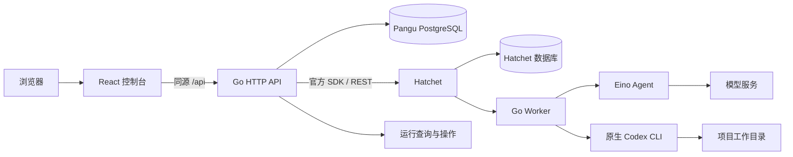
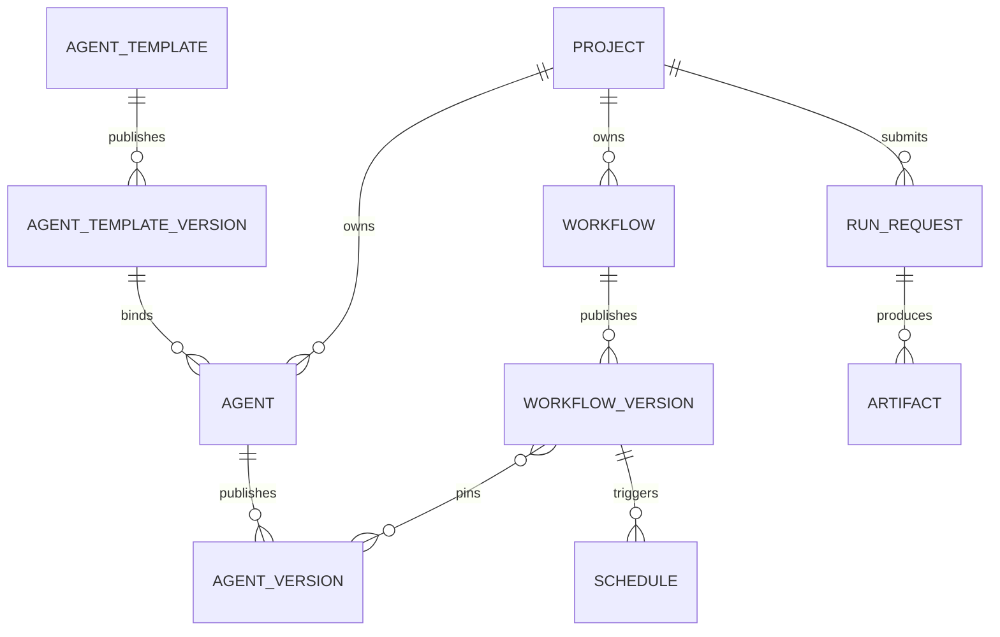

# Pangu 全栈架构设计

配置版本模块 `catalog` 只依赖 `database` 与 `workflow`：共享模板、项目 Agent、流程、连接复用同一草稿/版本协议；发布版本由数据库触发器禁止修改，绑定项目不可迁移。发布在事务中重新验证显式版本引用，草稿用修订号防止并发覆盖。配置每次从 PostgreSQL 读取，凭据只存服务端环境变量引用。运行快照不跟随草稿或隐式 latest；临时输入和指令保留 30 天，随后仅保留版本来源与摘要。

更新：2026-10-24。面向个人开发者和可信研发小团队，以 [产品需求](PRD-Pangu.md) 为目标。功能实现和外部验收分别记录于 [实施进度](实施进度.md)。

## 1. 架构结论与已落地范围

采用 **Go 模块化单体 + React/TypeScript/Vite + 独立 PostgreSQL 产品库 + Hatchet + Eino/原生 Codex**。API 和 Worker 可以一起启动，也可以分开部署；当前不拆微服务，不增加 Redis、消息中间件或第二套调度引擎。

需求已按用户确认更新为共享 Agent 模板/不可迁移项目绑定、Eino 产品经理角色和飞书登录；详见 [需求确认记录](需求确认记录.md)。下表保留基础工程范围，后续业务实现的准确状态以 [实施进度](实施进度.md) 为准，不将基础工程或模拟测试视为全部产品验收。

用户已确认 PostgreSQL 独立数据库与账号，以及前端基础工程。已有执行链路继续复用。本轮已落地：

| 基础能力 | 实现与边界 |
| --- | --- |
| 数据库 | 独立 `pangu` 库、`pangu_app` 账号；单独的 `pangu_test` 和测试账号；显式建库与事务迁移命令 |
| 数据迁移 | 内嵌 SQL、事务锁、迁移校验和、失败回滚、拒绝未知版本/历史缺口；业务表与迁移一并管理 |
| API 契约 | `api/openapi.yaml` 描述产品 DTO；前端类型自动生成并检查漂移，不直接暴露 Hatchet 原始载荷 |
| HTTP 基础 | 每请求生成追踪 ID；记录路由模板、状态码、耗时；不在访问日志记录路径参数、查询参数、请求体或认证头 |
| 校验与诊断 | `POST /workflows/validate` 不执行任务；`GET /readyz` 检查产品库和 Hatchet 编排注册；存活检查继续使用 `/healthz` |
| 前端 | 中文项目/成员、配置/版本、运行/产物、Cron、Token/审计页面，Go 内嵌同源托管；开发使用 Vite 代理 |
| 工程约束 | Go 模块依赖检查、函数行数检查、前端类型/测试/构建、数据库集成测试；统一行尾和锁文件 |

Worker 就绪、运行列表/取消、工作区隔离、Agent 版本库、产品经理工具、飞书权限和业务页面已接入。本地独立备份恢复已演练；真实模型、飞书应用与人工试点未完成验收。

## 2. 系统拓扑



当前本机两个数据库共用 PostgreSQL 实例，库和账号分开。这降低本地维护成本，但数据库实例故障仍会同时影响产品与调度服务；不等于高可用隔离。产品账号不是 PostgreSQL 超级用户，没有建库/建角色权限。初始化工具不自动改写已有密码或接管其他账号拥有的库。

浏览器不持有 Hatchet 令牌、数据库连接或模型密钥。Go 已嵌入前端并同源提供 `/api`；开发环境由 Vite 转发，不开放通配 CORS。远程部署需要配置认证、TLS 和反向代理，本机服务保持回环访问。

## 3. 模块边界与目录

```text
api/                         当前 HTTP 契约、契约校验
cmd/pangu/                   API/Worker/迁移入口与生命周期
cmd/database/                显式管理员建库工具，运行服务不依赖管理员凭据
internal/api/                HTTP 校验、状态码、依赖检查、请求追踪
internal/workflow/           定义、DAG 校验、数据传递规则
internal/scheduler/          Hatchet 注册、派生、查询、Cron 适配
internal/agent/              Eino/Codex 执行、进程生命周期
internal/database/           PostgreSQL 连接与前向迁移
internal/execution/          节点尝试、停止凭据、持久取消意图；依赖 agent 的原生进程身份/进程组核对，不接管 Hatchet 调度状态
internal/diagnostic/         凭据脱敏、日志截断与受控输出收集
internal/workspace/          已登记项目、独立 clone、成功检查点和不可变 Git 对象读取
internal/artifact/           Git 差异与研究报告清单、安全预览/导出；依赖 workspace、research 和 diagnostic
internal/catalog/            共享模板、项目 Agent/流程/连接草稿、不可变版本与引用检查
internal/research/           Eino 产品经理受控工具、公开网络边界、报告事务与来源记录；依赖 workflow/workspace/database/diagnostic
internal/submission/         请求键、提交快照、终态元数据归档与交接记录；依赖 database/workflow/diagnostic/identity
internal/identity/           飞书登录、会话、项目角色、Token；依赖 database/audit
internal/audit/              修改意图、结果及持久补录；依赖 database
internal/schedule/           计划与逐次触发记录、暂停和活动占位；依赖 database/workflow/submission，时间触发由 Hatchet 负责
internal/architecture/       模块依赖和单函数 70 行约束
web/src/api/                 生成类型与浏览器请求
web/src/                     状态与中文业务控制台
runtime/codex/              固定原生 Codex 版本的工具预算补丁与独立测试
scripts/                    本地服务、数据库初始化/环境与检查入口
docs/                       产品、架构、工程任务及验证记录
```

`workflow` 不依赖 HTTP、存储或调度；`agent` 依赖流程输入输出；`scheduler` 依赖流程定义并接入 Hatchet，同时调用 `agent.Verify` 执行管理员登记的验证命令，在成功文件检查点发布前记录真实退出证据；`api` 负责组合和协议转换。验证命令采用绝对程序路径和参数数组、独立临时用户目录、最小环境、30 秒超时与原生进程组停止，不经过 shell 拼接。入口只做进程组装。新增模块需要明确依赖方向后更新架构检查，不以放开全部依赖绕过检查。

`agent` 使用 `catalog` 读取模型连接、使用 `research` 注册受控工具；`scheduler` 为研究节点提供私有运行身份，报告与输出原子保存，节点重放读取已有报告；`artifact` 合并报告与 Git 产物。报告不占用整次运行的工作区锁，同层 Eino 节点仍可并行。`research` 只能读取原始 Git 基准及当前运行的直接上游报告，不能写项目文件。`identity` 逐请求读取权限，`audit` 持久记录修改意图及结果。现有 `api.Backend` 是 HTTP 测试边界。

前端业务按运行、Agent、工作流、定时任务等功能集中；先使用 React 状态及标准 `fetch`，实际出现跨页数据需求时再决定状态工具。服务端才是权限和配置校验的权威，页面校验用于及时反馈。

## 4. 数据归属与配置规则

| 数据 | 唯一权威来源 | 允许的产品侧数据 | 禁止事项 |
| --- | --- | --- | --- |
| 节点排队、执行、重试、恢复 | Hatchet | 运行 ID、协议转换、确认停止后的无正文历史摘要 | 修改 Hatchet 表结构、在产品库维护竞争的执行状态机 |
| 项目、Agent、流程、连接引用 | 产品库业务表 | 草稿、不可变发布版本、归档、乐观并发控制 | 进程内缓存配置、把密钥值写进版本快照 |
| 一次运行的定义 | 提交时完整不可变快照 | 定义版本引用、内容摘要、基准提交、来源运行 | 用后来编辑的配置偷偷替换历史运行输入 |
| 幂等提交与跨服务交接 | 产品请求记录 + Hatchet 可验证的提交标识 | 请求键、内容摘要、提交结果与对账状态 | 将本地事务误认为跨 Hatchet 的原子提交 |
| 代码和大产物 | Worker 管理的独立工作区 | 产物 ID、相对路径、摘要、大小、基准提交 | 在任务消息中传递完整仓库、允许客户端指定任意服务器路径 |
| 审计 | 产品库追加记录与待补录文件 | 操作者、对象、操作、版本、结果、时间 | 明文凭据、无上限的模型上下文或推理内容 |

读配置必须读原始来源；重载时重建派生索引。运行快照是执行证据，不是可变配置缓存。连接配置变化需要重建连接资源；当前数据库诊断每次读取环境并连接，没有保存业务配置或就绪结果。

本地 PostgreSQL 端口由 embedded 启动分配，`database-env.ps1` 每次从当前 `postmaster.pid` 读取端口并组合连接。密码保存在 Git 忽略的 `.tools` 文件中，不打印、不返回浏览器；它是本机开发存储，不宣称具备生产密钥托管能力。PostgreSQL 数据库与所有者的建立使用官方 `CREATE DATABASE` 机制，管理员凭据仅用于显式初始化。[PostgreSQL 文档](https://www.postgresql.org/docs/current/sql-createdatabase.html)

### 业务模型



业务迁移按工程任务落地：主体 UUID、项目作用域、时间戳；版本正文使用 JSONB 并由领域校验；发布版本不修改；草稿使用修订号防止覆盖并发编辑。删除与清理遵循历史引用和已确认的保留政策。

共享模板不绑定单一项目，可由多个项目使用；每次绑定创建独立项目 Agent，固定模板发布版本，`project_id` 不可修改。项目连接、路径、指令参数和运行资料不能回写进共享模板；共享模板管理与项目操作分别授权。模板升级不自动改变既有绑定。R07 的最小项目登记在 C01 延用，不创建两套身份。

### 已实现的角色与身份边界

首个 Eino 专业角色是产品经理。角色模板提供调研、竞品分析、产品规划和方案设计四种能力；底层工具负责公开搜索、网页/授权项目资料读取及报告产物登记，不能以提示词代替真实检索。网页资料不授予工具权限；请求限制目的地址、重定向、大小和时限。长报告走产物存储，节点仅返回摘要与引用；来源和未知项可追溯。仍使用 Eino 执行器与 Hatchet 节点，不增加第二套 Agent 调度框架。

团队登录使用飞书浏览器授权流程，由 Go 后端获取可信身份并建立 Pangu 会话；项目角色、成员禁用和 API Token 由 `identity` 管理。应用 Secret 只在服务端；浏览器不持有飞书用户访问令牌。飞书登录成功不等于项目授权，不自动将首次登录者设为管理员。官方概述说明后端获取用户身份后建立应用自身登录态，实际回调与权限规范在 U01 联调验证。[飞书官方登录概述](https://open.feishu.cn/document/client-docs/build-login-free-system-)

该登录选择不授权访问飞书文档、群聊或发送消息。Pangu 禁用成员的即时失效与飞书组织侧成员变化同步是不同事件；后者仍须验证接入方式，不能默认已有实时同步。

## 5. API 与前后端协作

[OpenAPI 契约](../api/openapi.yaml) 是当前 HTTP 接口说明；生成的 TypeScript 文件不手工编辑。OpenAPI 用于描述跨语言 HTTP 接口，当前选择工具链已支持的 3.0.3，不因追新而更换既有业务协议。[OpenAPI 官方规范](https://spec.openapis.org/oas/v3.0.3.html)

接口变更顺序：先改契约与失败测试 → 实现服务端 → `npm run generate` → 修改前端调用 → 契约检查、单元测试与构建。不引入 GraphQL 或额外 BFF。运行和 Cron 返回产品 DTO，Hatchet 原始输入、配置与凭据不返回调用方。

所有 HTTP 响应携带 `X-Request-ID`，浏览器可将该编号提供给维护者。访问日志不记录敏感输入；产品事件和诊断实施截断、脱敏与权限检查，管理员仍须控制第三方引擎原始日志的访问。

### 健康状态的准确含义

- `/healthz`：HTTP 进程存活。
- `/readyz`：产品库可连接且迁移匹配，Hatchet 可访问且固定编排已注册。响应 `scope=api_dependencies`；503 不泄露连接错误原文。
- 认证配置缺失时服务拒绝业务请求。`/readyz` 不代替实际 Worker 提交前诊断；后者检查心跳、执行器、项目、模型连接及 Codex 专用配置/能力/登录状态，不调用模型验证额度。
- 产品数据库已参与身份、配置编译、持久提交、幂等、工作区与审计。202 表示意图持久化；回执暂缺时通过请求记录轮询与对账。

## 6. 执行可靠性与代码交付设计

Hatchet 为每个 Agent 独立调度、重试和恢复。当前按层等待；Codex 在同命名空间串行。命名空间可登记多个项目，Worker 按项目登记定位目录，Cron 使用 UTC；不提供多机自动路由。

写入链路：固定 Git 基准 → 创建平台管理的独立本地 clone → 保存托管副本内的节点检查点 → 执行/验证 → 留存差异和证据 → 用户决定采纳。源文件、源 `.git` 和分支不修改，不接受客户端任意绝对路径。重新运行使用新运行和干净工作区，关联原定义/基准/来源；原基准过期且不可恢复时明确失败，不替换为最新代码。

| 故障 | 处理规则 |
| --- | --- |
| API 请求超时 | 不能据此认定运行已取消；客户端通过请求标识查询，重新提交须经过幂等处理 |
| 产品库提交成功但 Hatchet 返回丢失 | 持久交接记录配合 Hatchet 幂等/请求标识查询进行对账；不能把提交幂等扩大解释为外部工具恰好一次 |
| Worker 重启 | Hatchet 恢复调度；工作区记录必须可定位、与已完成节点文件结果一致，否则明确失败，不静默切换目录 |
| 写入节点中途失败 | 失败尝试的文件不能混入重试输入；已成功上游的产物仍须保留，详见 R08/R09 |
| 用户取消 | 阻止新节点派生，停止排队和活动子任务，清理进程；完成与取消的竞态要有确定响应 |
| 外部工具产生副作用 | 数据库重试不能回滚远端副作用；需工具幂等约束和明确记录，不承诺恰好一次 |

工作区隔离不等于操作系统权限隔离。可信团队阶段仍要求 Worker 管理者信任 Codex 配置、规则与工具；面向互不信任用户前，必须另行设计独立账号或容器等运行隔离。

## 7. 部署、测试与扩展路径

当前部署是 Windows 单机：Go API/Worker、Hatchet embedded、独立产品库、嵌入 Go 程序的 React 静态文件。数据库初始化、产品迁移、运行服务分开执行。安装包同源访问8081；开发时 Vite 为5180并代理API。已提供显式启停、冷备份、校验恢复脚本；远程 TLS、正式密钥管理与干净机器验收仍需部署者完成。

基础检查分层：Go 单元/架构/契约测试；独立 `pangu_test` 真实迁移测试；前端组件测试、契约漂移检查、类型检查、构建；真实本地 API 与浏览器检查。CI 配置 Linux/Windows Go 检查、Linux PostgreSQL 和竞态检测、前端检查。配置已落地不代表远端 CI 已执行。

迁移只前进，应用过的文件不可编辑。事务内执行 SQL 与历史记录，迁移锁避免并发执行；校验和依赖固定 LF 行尾，Git 属性对此作约束。后续涉及数据转换必须先备份并验证新旧程序运行边界；不自动降级或清空库。

扩展顺序：运行操作和产物 → 共享模板与项目绑定、产品经理角色 → 飞书登录和团队控制台 → 有实际瓶颈后增加独立 Worker 路由/调度优化。当前没有负载基线，不虚构并发容量、可用率或模型费用；R17 的真实流程报告先建立依据。部署/保留/升级数值按已确认 Q05、Q14、Q15、Q28–Q30 执行。

## 8. 本次决策记录

| 决策 | 原因 | 代价与重新评估条件 |
| --- | --- | --- |
| 模块化单体 | 当前模块少，沿用现有 Go 实现即可交付 | 模块边界需测试约束；确有独立扩容/部署需求时才拆服务 |
| 产品库独立，复用本地 PG 实例 | 需要事务、版本与幂等元数据，又避免增加本地运维服务 | 共用实例故障域；上线前评估独立实例及备份 |
| React + TypeScript + Vite | 用户已确认，适合本地操作控制台；前端仅访问 Go API | 构建机需要 Node；安装包已内嵌静态文件，运行机不需要 Node |
| OpenAPI 与生成类型 | 让前后端接口可对照、可检查 | 生成文件需随契约提交；运行时仍须校验外部响应 |
| 逐项建表与新增模块 | 避免空架构和未经使用验证的通用框架 | 每项功能承担自己的迁移和边界设计 |
| 先定义幂等与文件恢复，再开放写入操作管理 | 代码修改有持续副作用，不能只完成按钮/API | 技术验证是后续实现的前置任务，不跳过失败场景 |
