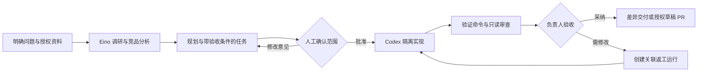

# Pangu 竞品对比与优化建议

分析日期：2026-10-24。Pangu 基准：`feat/agent-factory`，提交 `25beeb7`。

本文保留 2026-10-24 分析时的产品基准。用户随后已采纳 O01–O09；当前实现与验证以[优化实施进度](优化实施进度.md)为准，不能将下文的历史短板视为最新状态。既有约定见[需求确认记录](需求确认记录.md)，底层方案依据见[竞品与技术决策](竞品与技术决策.md)。

## 1. 结论

**继续采用 Hatchet + Eino + 原生 Codex，把投入重点从增加执行能力转向提高交付物的可用性和团队采纳率。** 当前最紧迫的问题是验证真实任务价值、降低配置门槛，以及连接产品经理报告与代码交付。

本次调研改变了两个竞争判断：

- **原生编码 Agent、本地执行和多 Agent 编排已不是独有能力。** OpenHands Agent Canvas 已公开支持 Codex、ACP、独立 Git worktree 与自动化；2026 年 10 月 7 日发布的九月更新还覆盖 Issue 准备度检查、开发、PR 审查和持续反馈。[产品说明](https://www.openhands.dev/product/canvas)、[九月更新](https://hub.openhands.dev/blog/new-in-agent-canvas-september-2026)
- **Go + Eino 也不是产品差异。** Coze Studio 已采用 Go、React + TypeScript，提供 Agent、工作流与知识资源；其后端依赖中直接包含 Eino。[官方仓库](https://github.com/coze-dev/coze-studio/blob/main/README.md)、[后端依赖](https://github.com/coze-dev/coze-studio/blob/main/backend/go.mod)

建议验证的定位是：**面向使用飞书的可信小团队，将有来源的产品调研、任务设计、受控代码执行和人工验收连成可追溯流程。** 这是基于现有能力的定位假设，尚没有用户研究证明团队会因此选择 Pangu。

## 2. 比较范围与证据口径

选择六个有代表性的项目，而不是声称穷尽所有开源项目。OpenHands 是编码 Agent 的直接对照；Dify、Coze Studio 是 Agent 应用构建的对照；n8n、Windmill 是业务及开发自动化的对照；LangGraph 是状态管理与恢复的框架参考，不是同形态的管理平台。

竞品事实来自截至分析日可访问的官方文档、仓库和更新记录；Pangu 事实来自仓库文档及相关实现。本文没有部署竞品、进行统一任务压测或比较付费价格，因此不提供可靠性、性能、成本或模型质量排行榜。

版本边界必须保留：

- Dify 本文引用的人工输入功能来自 Cloud 文档，自托管目标版本需要另行核对。[人工输入节点](https://docs.dify.ai/en/cloud/use-dify/nodes/human-input)
- Coze Studio 开源仓库与 Coze 在线产品不是同一个功能集合，不将在线产品的触发器等能力直接记入开源版。[仓库功能清单](https://github.com/coze-dev/coze-studio/blob/main/README.md)
- n8n 社区版不包含项目、工作流/凭据共享、SSO 和 Git 源码管理等完整团队能力；不能拿商业版功能当作社区版默认配置。[社区版边界](https://docs.n8n.io/hosting/community-edition-features/)
- Windmill 的基础暂停/恢复与审批表单、高级审批权限有版本区别，后两者在文档中标为 Cloud/Enterprise。[审批文档](https://www.windmill.dev/docs/flows/flow_approval)

“可自托管”和“所有商业功能免费可用”是不同问题。这里比较能力与产品路径，不给出许可证合规结论。

## 3. 逐项对比

| 对照项目 | 官方资料证实的相关能力 | Pangu 当前对比 | 应吸收的做法与取舍 |
| --- | --- | --- | --- |
| **OpenHands** | 接入已有编码 Agent，隔离工作区，Issue 到 PR 的持续工作流。[Canvas](https://www.openhands.dev/product/canvas)、[开发闭环](https://hub.openhands.dev/blog/new-in-agent-canvas-september-2026) | 已有 Codex 托管副本、检查点、验证证据和差异导出；报告任务尚不能直接成为待执行任务，也没有平台 PR 交付闭环 | 学习任务准备度、审查反馈和交付关联。Pangu 需要证明产品调研与团队验收带来的价值，不能仅宣传“Agent 工厂” |
| **Dify** | 可配置 Agent 节点；人工输入节点支持表单、暂停、决策路由和超时。[Agent](https://docs.dify.ai/en/cloud/use-dify/nodes/agent)、[人工输入](https://docs.dify.ai/en/cloud/use-dify/nodes/human-input) | 已有中文控制台、版本和参数校验；配置主体仍是 JSON，DAG 只读，缺少业务审核后的继续执行 | 先做表单、版本选择与审核入口，再按实际需求增加画布；不为追齐聊天应用平台重做底层 |
| **Coze Studio** | Go + Eino 技术基础，Agent/工作流编辑发布，插件、知识库、数据库与提示词资源。[仓库](https://github.com/coze-dev/coze-studio/blob/main/README.md)、[依赖](https://github.com/coze-dev/coze-studio/blob/main/backend/go.mod) | 共享模板及项目绑定已具备，产品经理角色与原生代码执行能混编；资源使用和配置体验仍较工程化 | 参考模板到首跑的路径、资源选择体验；不因技术栈相同就整体迁移，也不急于建设通用插件市场 |
| **n8n** | 可对 Agent 的具体工具调用加入人工批准；用数据集和指标评测 AI 工作流。[人工审核](https://docs.n8n.io/advanced-ai/human-in-the-loop-tools/)、[评测](https://docs.n8n.io/advanced-ai/evaluations/overview/) | 已有工具限制、审计和运行证据；缺少产品内采纳记录、固定评测集与版本质量比较 | 学习按风险设审核点和用真实失败样本回归。先连接一条高频业务路径，不以连接器数量为目标 |
| **Windmill** | Agent 可嵌入流程并调用脚本工具，支持迭代/输出 token 限制；流程可暂停等待恢复事件。[Agent](https://www.windmill.dev/docs/core_concepts/ai_agents)、[暂停与审批](https://www.windmill.dev/docs/flows/flow_approval) | Pangu 有节点期限、工具次数、Cron 和原生命令验证；尚缺任务用量预算与人工等待生命周期 | 借鉴执行资源可见性和持久等待；保留项目权限，不照搬持有链接即可批准的模式 |
| **LangGraph** | 检查点、持久中断、恢复，以及从历史检查点重放或分叉。[中断](https://docs.langchain.com/oss/python/langgraph/interrupts)、[分叉](https://docs.langchain.com/oss/python/langgraph/use-time-travel) | Pangu 已能故障恢复，并按原定义/原基准新建重跑；尚无用户修改反馈后从指定节点创建分支的产品操作 | 借鉴恢复与有意分叉的区分；保留 Hatchet 调度，不引入第二套运行状态权威 |

## 4. Pangu 已有基础与真实短板

### 应保留的已有能力

这些是已投入并经过本地验证的基础，不等于比所有竞品都强：

- 每个 Agent 节点独立调度、重试、恢复；取消意图、进程停止与回执丢失有明确处理。
- 运行与尝试使用托管 Git 副本，成功产物有检查点；源项目不被直接修改。
- 草稿与不可变发布版本分开；跨项目模板绑定后形成不可迁移的项目 Agent，计划固定版本。
- 飞书身份、项目权限、范围 Token、审计及凭据引用已经接入；配置读取原始来源，不以缓存替代授权。
- 产品经理已实现调研、竞品、规划、设计四模式，以及受控来源读取和报告登记。
- 中文控制台已覆盖配置、运行、计划、权限与产物，不是只有 API 或状态页。

证据见[实施进度](实施进度.md)、[产品经理使用说明](模板与产品经理使用.md)及[控制台设计](控制台界面设计.md)。

### 应优先解决的短板

| 用户的问题 | 当前边界 | 对产品价值的影响 |
| --- | --- | --- |
| “我怎样完成第一次有用的运行？” | 需要理解项目、连接、模板、版本及 JSON；已有预检查但缺少贯通的引导 | 非开发成员较难独立开始；实际耗时尚未测量 |
| “成功的报告或代码是否真的有用？” | 有执行/验证证据；人工采纳仅在试点表中记录，缺少产品内评价闭环 | 无法稳定比较模板或模型改动后的交付质量 |
| “先让我确认方案，再继续开发。” | 现有 DAG 不包含持久人工审核节点 | 调研与开发之间需要人工在平台外接续 |
| “这些设计任务能直接安排执行吗？” | 设计模式输出 1–32 项带依赖任务，但只作为报告交付 | 报告与执行任务仍需人工转换 |
| “引用真的支持这个结论吗？” | 已有实际读取来源、时间和未知项要求；来源可追溯不等于论证成立 | 可能生成引用合法、结论却不足以决策的报告 |
| “为什么慢、为什么贵、是否值得重跑？” | 有尝试和失败证据、次数与期限；缺少完整的 token、金额及采纳成本口径 | 使用者难以决定模型与重试策略 |
| “修改意见后能只重做后半段吗？” | 当前重跑使用原定义和原基准创建新运行 | 交互式返工体验不足，但不能因此复用未经验证的旧产物 |

配置编辑和只读流程图可分别定位到 [CatalogEditor](../web/src/catalog/editor.tsx) 与[流程展示](../web/src/runs/workflow.tsx)。报告任务不自动执行、工具额度和来源授权边界见[产品经理说明](模板与产品经理使用.md)。

## 5. 优化任务与验收条件

P0 是先验证价值与降低使用门槛；P1 是经过试点确认后扩大闭环。下面是候选任务，不修改原 46 项任务的完成状态，也不隐含增加人力或承诺日期。

| 编号 / 优先级 | 最小可交付范围 | 完成的证据 | 依赖与边界 |
| --- | --- | --- | --- |
| **O01 / P0：完成真实试点** | 沿用已有试点清单，接入真实飞书、模型、Brave；完成三角色使用和干净 Windows 安装 | 10 次真实任务至少 8 次人工采纳；记录返工、耗时、费用来源；恢复/权限阻断问题关闭 | 需要账号、预算、真实任务和人的判定。不是继续增加模拟测试就能关闭 |
| **O02 / P0：首次运行向导与表单** | 将已有预检查串成“环境→项目→连接→模板→运行”；从现有参数结构生成表单，用选择器引用真实发布版本，保留高级 JSON | 试点操作者无需手填 UUID/JSON 即可完成示例任务；版本归属和错误定位正确；记录求助次数及首跑耗时 | 复用现有权限与校验；不新增配置缓存或另一套定义格式 |
| **O03 / P0：采纳反馈与最小评测集** | 产物增加采纳/需修改/拒绝、负责人和原因，绑定运行及产物版本；从真实失败建立回归样本 | 执行成功与业务采纳分开统计；同一任务多次重跑不膨胀采纳率；模板升级能展示同一批样本的前后结果 | 先复用已有试点表，再建设产品内记录；固定用例输入、预期与评测规则需单独批准保留 |
| **O04 / P1：持久人工审核** | 首先支持节点之间审核：方案获批再开发，产物获批再发布；不在每一次工具调用上打断用户 | 服务重启后仍能批准/驳回；越权、重复点击、过期审批无效；批准绑定具体方案/版本/产物摘要，内容变化使旧批准失效 | 复用项目角色与审计；人工等待期限必须与运行、节点、排队期限分开设计，不能静默绕过现有 6 小时上限 |
| **O05 / P1：方案到交付闭环** | 人工选择并确认设计任务，生成有范围/依赖/验收条件的执行草案；Codex 执行、验证、只读审查后交由人采纳 | 每份代码产物能追溯到获批任务与验证结果；失败或未批准的任务不能发布；重试不会重复创建交付 | 依赖 O03/O04。先交付现有 diff/ZIP；GitHub 草稿 PR 是显式授权的后续出口，不默认 push、合并或发消息 |
| **O06 / P1：产品经理证据质量** | 在现有来源记录上关联关键结论与具体依据，展示资料日期、范围冲突和推断；检查“读过”和“支持结论”的区别 | 人工抽样可定位关键结论依据；无法证实的内容保留未知；来源失效/冲突不会变成确定结论；评测能复现已发现问题 | 依赖 O01/O03 的真实样本；不以来源数量机械判定可信，不默认扩大公开查询授权或工具额度 |
| **O07 / P1：用量、预算与故障定位** | 展示节点排队/执行时间、调用与重试消耗、提供方返回的 usage；区分账单实值、价格估算、不可获取 | 用户能看出主要等待和消耗来自何处；预算耗尽停止新增收费调用；未知费用不显示为零；并发预算检查不会重复透支 | 先记录真实数据，再设预算。已发出的调用可能仍收费；Codex 订阅用量不能伪装成精确单次金额 |
| **O08 / P1：一条团队事件入口** | 根据试点选择飞书审核提醒或 GitHub 任务触发中的一个；将事件映射到已有项目、固定版本和幂等提交 | 签名/授权/重复事件验证通过；撤销权限后不能发起新任务；通知失败不重复执行工作流；入口能返回可追溯运行 | 依赖 O03/O04 或 O05 的实际场景。飞书登录不等于拥有消息、文档权限；发送与外部写入必须明确启用 |
| **O09 / P1：受限分支与返工** | 先补输入预览和节点错误定位；真实流程需要时增加类型受限的条件分支、从成功检查点创建返工运行 | 新运行记录父运行/节点/输入变化，旧历史不被覆盖；依赖或输入变化使受影响结果失效；外部副作用不会因重放被误认为可撤销 | 依赖 O03/O04 的返工样本。自动故障恢复与人工修改后的分叉分开；不引入任意脚本或无界循环 |

O01 的既有验收材料见[试点验收](试点验收.md)。O03 的做法参考 [n8n 评测](https://docs.n8n.io/advanced-ai/evaluations/overview/)；O04 参考 [Dify 人工输入](https://docs.dify.ai/en/cloud/use-dify/nodes/human-input)与 [LangGraph 中断](https://docs.langchain.com/oss/python/langgraph/interrupts)；O09 参考 [LangGraph 分叉语义](https://docs.langchain.com/oss/python/langgraph/use-time-travel)。这些是交互和状态设计参考，不代表直接替换 Pangu 的执行引擎。

建议推进次序：**先 O01/O02/O03；根据失败与采纳数据选择 O06/O07；再用 O04/O05 打通一个真实交付闭环；O08/O09 由高频使用需求触发。** O01 的资源等待期间可以推进 O02/O03，但不能用新功能完成情况代替试点结果。

## 6. 首个完整场景

建议优先打通“小范围产品改进”，比建设通用自动化市场更贴近已有三类模板。下图是目标流程，不是当前已全部支持的流程。

产品经理负责给出证据和任务，原生 Codex 负责受限实施；验证结果来自真实命令；负责人决定是否采纳。先把这一条链路做顺，再考虑更多 Agent 角色。

第二个场景可复用现有 Cron 做“定期竞品变更报告”：最小交付是有日期和来源的报告。跨期差异比较需要明确保存已认可的基线；飞书推送需要额外授权，不能把这两项误记为现有 Cron 已经具备。

## 7. 衡量方式

| 指标 | 口径 | 使用方式 |
| --- | --- | --- |
| 首次有效产出耗时 | 从凭据已准备、开始产品配置，到首次经人确认可用的产物；部署耗时另记 | 先测基线，再定目标，不引用竞品宣传的“五分钟”作为实测对照 |
| 首次独立完成率 | 无现场指导完成约定操作的人数 / 实际参与人数，并记录求助 | 验证向导是否真的降低门槛 |
| 首次采纳率 | 第一次交付被采纳的任务数 / 已完成首次评价的任务数；未评定单列 | 识别依赖大量返工的表面成功 |
| 最终采纳率与返工 | 按业务任务去重统计最终采纳、拒绝及返工次数 | 保留现有“10 次至少 8 次采纳”验收门槛，另补任务层统计，不用重跑刷分 |
| 每项采纳任务的消耗 | 该任务及所有尝试的可取得用量/费用，加人工审查时间；未知项单列 | 比较模板与模型版本，不能只看成功那一次 |
| 关键结论证据质量 | 抽样结论中依据支持、范围相符、日期适用的比例，附样本和判定理由 | 样本量不足时展示原始结果，不包装成可靠总体结论 |
| 排队与人工等待 | 排队、执行、等待审核分别计时 | 判断下一步该优化容量、执行还是团队协作 |

十次任务足以发现明显问题，但不足以证明长期稳定达到 80% 采纳率。试点通过后应保留失败样本，持续观察代表性任务，而不是宣布普遍质量保证。

## 8. 暂缓事项与架构约束

- **不更换 Hatchet 或整体迁移到 Coze。** 当前问题主要是产品流程和质量验证；没有发现必须换引擎才能解决的证据。
- **暂不建设完整拖拽画布、插件市场或更多执行器。** 表单、引用选择、输入预览和错误定位先解决现有操作成本；画布需要试点证明价值。
- **暂不建设多租户 SaaS、Kubernetes 集群和复杂计费。** 当前承诺是可信小团队、Windows 单机；扩展需由真实容量与部署需求驱动。
- **有限并发后置。** 当前 Codex 在同一命名空间串行。先记录跨项目排队，再评估项目间并发；同一工作区写入仍需隔离与一致性验证，不能只调高并发参数。
- **项目知识资产应独立设计。** 经人认可的 PRD、决策和评测样本可以成为候选长期资产，但必须有版本、权限与删除规则；不静默延长现有 30/90/180 天保留期，不将知识检索变成配置缓存。
- **原生 Codex 升级是持续维护成本。** 保留受控版本及硬限制回归；将来评估 ACP 或 App Server 时，要证明覆盖现有内置工具限制、取消和沙箱要求，不能只因协议通用就删除控制。现有选择依据见[技术决策](竞品与技术决策.md)和[受控构建](../runtime/codex/README.md)。

当前最应补齐的是实际飞书、真实模型与搜索、干净操作系统安装和真人采纳证据。本文没有证明 Pangu 的性能、质量或成本优于竞品；也没有将下一版的审批、外部发布、分支、并发或长期资产建议写回既有确认规则。
